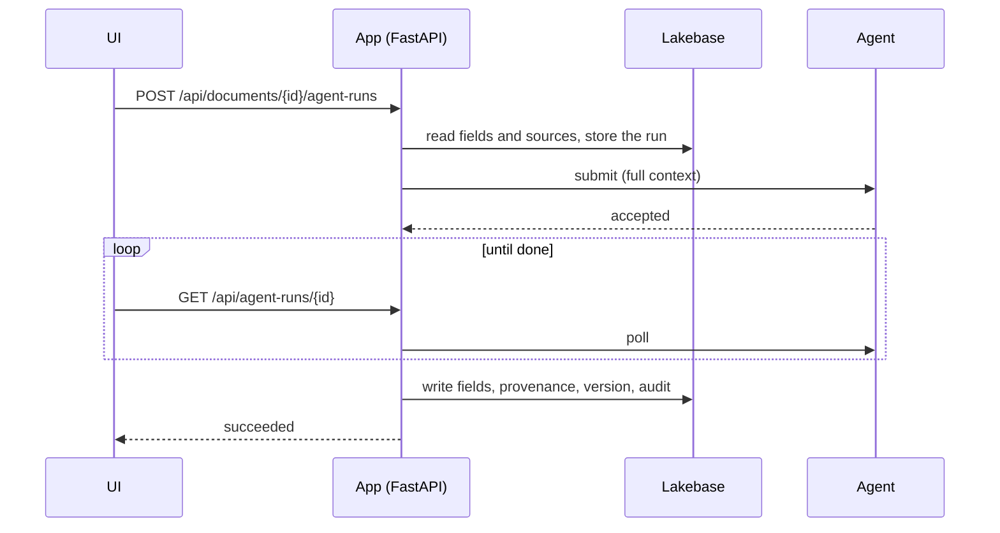

# {{project_title}}

A starter harness for Databricks Apps projects: a web app where people work on records and an AI
agent drafts, edits and answers questions about them. Everything is wired end to end - sign-in,
permissions, a Lakebase database, the agent, evals, deploys to dev/test/prod and CI/CD - so a
project starts from a working app and changes the parts that are specific to it, by hand or with an
AI coding assistant.

Out of the box it runs a small sample: **briefs**. A user writes a title and a goal, the agent drafts
the summary, key points, risks and next steps (citing other documents the user picks), and the user
reviews, edits, asks for revisions and chats about it. Swap "brief" for your project's records.

## Is it a fit?

**Good fit:** an internal tool where users create and review records with an agent's help -
drafting, extraction, enrichment, Q&A over the record, human-in-the-loop approval. You want
provenance (what the agent wrote, why, from which sources), versions and an audit trail.

**Use something else for:** a dashboard over tables (AI/BI dashboards), a batch pipeline (Lakeflow
jobs), a chatbot over a document corpus with no records to edit (Agent Bricks).

## What you get

| | |
| --- | --- |
| App | FastAPI + React 19 (Vite, Tailwind 4, shadcn/ui, TanStack Query) in one Databricks App; API types generated for the UI |
| Data | Lakebase Postgres per target, SQLAlchemy + Alembic migrations applied at startup; local dev and tests on real Postgres with no Docker |
| Agent | LangChain on a Databricks Model Serving endpoint, behind a versioned submit/poll contract; a fake agent for building and testing without a model |
| Access | Databricks Apps sign-in; roles (viewer, editor, admin) plus per-document sharing |
| Quality | Strict typing and linting, ~130 Python and ~20 UI tests, MLflow evals and tracing |
| Ship | Declarative Automation Bundles (dev/test/prod), GitHub Actions and GitLab CI with keyless deploys |
| Guidance | `AGENTS.md` for AI coding assistants; a docs site with guides and design decisions (`make docs`) |

## Run it in 5 minutes

You need [uv](https://docs.astral.sh/uv/), Node.js 22.22+, and `make`.

```bash
make setup                  # Python and Node dependencies
cp .env.example .env        # then put your email in DEV_USER_EMAIL and APP_ADMIN_EMAILS
make dev                    # local Postgres, the API on :8000, the UI on http://localhost:5173
```

No Databricks workspace is needed: locally you are signed in as `DEV_USER_EMAIL`, and the agent is
the fake one. Try it: **Documents → New brief**, create two, tick one as a source in the other,
**Generate**, open **Why?** on a field, use the sparkle button to ask for a revision, chat in the
**Assistant** tab, and look at **History**.

To use a real model, add `DATABRICKS_CONFIG_PROFILE` and `LLM_ENDPOINT` (a serving endpoint in that
workspace) to `.env`.

## Make it yours

1. **Create your repository** from this template (GitHub: *Use this template*; GitLab: import it).
   Keep one CI system: delete `.gitlab-ci.yml` or `.github/`.
2. **Fill in the placeholders** - names, admins, workspace hosts, model endpoint:

   ```bash
   make init NAME=claims-portal ADMINS=you@example.com \
     DEV_HOST=https://adb-1111.1.azuredatabricks.net LLM_ENDPOINT=databricks-claude-sonnet-5-5
   ```

   `python3 scripts/init_project.py --check` lists anything still unset (test and prod hosts can
   come later).
3. **Model your records** in `contracts/field-catalog.yaml`: document types, their fields, and which
   fields the agent writes. The forms, the API checks and both agents follow the catalog.
4. **Teach the agent your domain**: the prompts in `backend/agents/prompts/`, and rows in
   `evals/dataset.jsonl` that show what good output looks like. Need more than drafting, revising and
   chatting? Add a run kind (`docs/content/guides/adding-a-run-kind.md`).
5. **Shape the UI**: pages in `frontend/src/pages/`, the workspace parts in
   `frontend/src/components/documents/`.
6. **Deploy**: sign in to the workspace with a named CLI profile
   (`databricks auth login --host <host> --profile <name>`), then
   `make deploy TARGET=dev PROFILE=<name>`. An admin grants roles under **Users & roles**.
7. **Turn on CI/CD** (`docs/content/guides/deploy-and-ci.md`).

## Working with an AI coding assistant

`AGENTS.md` is the brief for any assistant (`CLAUDE.md` points Claude Code at it): the commands, the
rules that keep the architecture intact, where each kind of change goes, and recipes. Start a
session with something like:

- *"Read AGENTS.md. Replace the brief document type with a 'customer request' that has these fields:
  ... The agent should draft a triage summary and a proposed owner. Update the prompts, the evals
  and the tests."*
- *"Read AGENTS.md. Add a run kind that checks a document against a policy and returns findings per
  field, with a page to review them."*

Ask it to finish with `make lint test` (and `make eval DEV=1` for agent changes). The tests, the
contract checks and the boundary test catch most changes that break the design.

## How it works



- **The app owns the data; the agent owns nothing.** Every run carries everything the agent needs
  (the record, the chosen sources, the recent conversation), so the agent keeps no state and can be
  restarted, scaled or redeployed freely.
- **Runs are asynchronous.** Submitting returns at once; the UI polls and shows each step. Model
  latency never meets the Apps proxy's 120-second request limit.
- **Results land in one transaction**: field values with their source, confidence, reasoning and
  citations, a version snapshot and audit rows. Suggested revisions only land when the user accepts.
- **The contract is written down** in `contracts/agent-api-contract.md`, and tests check the code
  against every example in it. The agent runs inside the app by default and can move to its own app
  with one setting (`AGENT_TRANSPORT=http`).
- **The fake agent speaks the same contract**, so the UI and app logic can be built and tested before
  the real agent is ready - and CI never needs a model.
- **Users' feedback lands on the run's MLflow trace**: thumbs up/down with reasons on each field and
  answer, accepted and dismissed suggestions, and every correction a user makes to what the agent
  wrote (as the expected value). In Databricks you filter traces by it, and `make eval-dataset`
  turns it into eval cases (`docs/content/guides/user-feedback.md`).

The docs site (`make docs`) covers each part, with the design decisions behind them.

## Commands

| Command | |
| --- | --- |
| `make dev` | run locally; `make agent` runs the agent on its own for split-mode work |
| `make lint` / `make fmt` | check / fix formatting, linting and types |
| `make test` | backend and frontend tests |
| `make api-types` | regenerate the UI's API types after an API change |
| `make migration MSG="..."` | create a migration after a model change |
| `make eval DEV=1` / `make eval PROFILE= LLM_ENDPOINT=` | evaluate the agent offline / against the real model |
| `make eval-dataset PROFILE= EXPERIMENT=` | turn users' feedback on real runs into eval cases |
| `make deploy TARGET= PROFILE=` / `make destroy ...` | deploy or remove a target |
| `make docs` | serve the docs site on :3000 |
| `make help` | everything else |

## Where things live

```
contracts/          the agent contract and the field catalog - start here
backend/
  api/ services/    routes (thin) and the logic behind them
  domain/ db/       tables, API shapes, database setup
  auth/             identity, roles, per-document access
  agents/           the agent: runtime, prompts, LangChain runners, the fake agent
frontend/src/       pages, components, typed API client and hooks
alembic/            migrations
tests/ evals/       tests and the agent evals
docs/               the docs site: guides and design decisions
databricks.yml resources/ app.yaml   what gets deployed
```

## Things to know

- **Placeholders block deploys.** `make deploy` refuses to run until `make init` has filled them in.
- **Workspace commands always take `PROFILE=`**; nothing uses your default CLI profile, and each
  target pins its host, so a wrong profile fails instead of deploying elsewhere.
- **The dev target is shared**: development mode doesn't make app or database names per-user.
- **Deploy before pointing local dev at Lakebase**: the app's service principal must create and own
  the schema.
- **Without a model endpoint a deployed app won't start**, unless you set `AGENT_RUNNER=fake` in
  `app.yaml` on purpose (useful until the endpoint is available).
- **Recent Claude endpoints reject `temperature` and forced tool calls**; the agent code already
  handles both (`AGENTS.md`, rule 8).
- **Lockfiles must use public registries.** Behind a package mirror, set `PYPI_MIRROR` before
  `make lock`.
- **Python 3.12** comes from uv. If a workspace can't download it at deploy time, switch to 3.11
  (`requires-python` and `.python-version`), then `make lock`.
