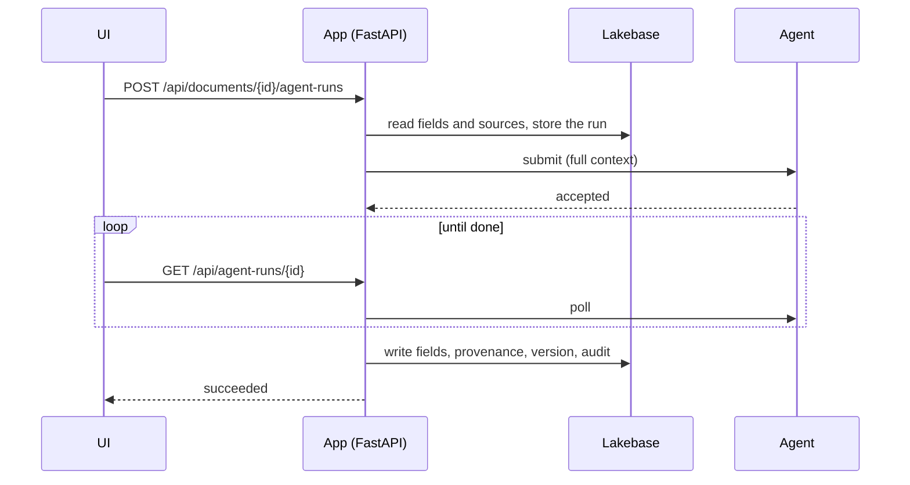

# {{project_title}}

A general-purpose starting template for FDE agentic applications on Databricks Apps. Choose a
working example, replace its schemas and prompts, and customize its UI. Shared infrastructure
provides authentication, asynchronous execution, AG-UI interactions, Lakebase persistence,
MLflow tracing and feedback, and deployment to dev/test/prod.

| Example | What it demonstrates |
| --- | --- |
| **Chat** | Streaming conversations, persisted history, optional context and answer feedback; no documents required. |
| **Generation** | A topic/audience/constraints form, progressive structured output, editing and explicit acceptance or rejection. |
| **Documents** | Brief records, cited drafts, before/after review, atomic acceptance with stale-edit protection, and `focus_field` frontend actions. |

Each example can be disabled independently with `ENABLED_EXAMPLES=chat,generation,documents`.
Chat and generation do not load the document field catalog. There is no plugin service or package
publishing workflow: the registrations and callbacks are ordinary application code in this repo.

## What you get

| Layer | Supplied integration |
| --- | --- |
| UI | React 19, shadcn/ui, TanStack Query for persisted data, official AG-UI client for active interactions |
| API | FastAPI, generated TypeScript types, permission checks and idempotent submission |
| Data | Lakebase Postgres, SQLAlchemy, Alembic; local development and tests use real Postgres without Docker |
| Runtime | Fake and real Databricks runners, validated input/results, streamed provisional state, MLflow tracing |
| Recovery | Ordered durable events, SSE heartbeats, cursor polling fallback, background collection after browser disconnect |
| Deployment | Databricks Apps, Declarative Automation Bundles and GitHub/GitLab CI |

## Run it locally

You need [uv](https://docs.astral.sh/uv/), Node.js 22.22+ and `make`.

```bash
make setup
cp .env.example .env        # set DEV_USER_EMAIL and APP_ADMIN_EMAILS
make dev                   # API :8000, React http://localhost:5173, local Postgres
```

Open the example selector. Try **Chat** and revisit the conversation; try **Generation** and edit
before accepting; try **Documents → New brief → Generate** and review the proposed fields. New
agent drafts do not change accepted data until you accept them. The fake runner needs no credentials.

Set `DATABRICKS_CONFIG_PROFILE` and `LLM_ENDPOINT` in `.env` to use a real model. Per-agent overrides
are supported, for example `AGENT_RUNNER_OVERRIDES=chat=real,generation=fake`.

## Make it yours

1. **Choose an example.** Copy this template, keep the relevant examples with `ENABLED_EXAMPLES`,
   and choose one CI system. Remove the unused registrations when you want to delete their code.
2. **Replace schemas and prompts.** Start with `backend/contracts/examples.py` and
   `backend/agents/example_registry.py`. Only document applications need `contracts/field-catalog.yaml`.
3. **Register capabilities.** Add an `AgentDefinition` for runtime execution and an
   `AgentApplication` for application authorization, context and result persistence. Core run kinds,
   transport and lifecycle code do not change.
4. **Customize the UI.** Use `frontend/src/agent/` primitives and register your page in
   `frontend/src/examples/registry.tsx`. Add domain tables only when your application needs them.
5. **Deploy.** Run `make init NAME=my-app ADMINS=you@example.com DEV_HOST=<workspace-url>
   LLM_ENDPOINT=<endpoint>`, sign in with a named Databricks CLI profile, then
   `make deploy TARGET=dev PROFILE=<profile>`. An admin grants roles under **Users & roles**.

See [the extension recipes](docs/content/guides/agentic-applications.md) for an agent, frontend tool,
result renderer, persistence callback and example removal. See [execution v2](contracts/execution-v2.md)
for the protocol. The existing [v1 document contract](contracts/agent-api-contract.md) remains supported.

### Recovery and migration

SSE and JSON polling read the same event journal. Reconnecting attaches to an existing run and never
submits inference. The cursor envelope is an **application transport extension**, not standard AG-UI
SSE resumption. Events recover viewing state; an agent-process restart can still produce
`AGENT_RUN_LOST`. Persistent interrupt/resume workflows and arbitrary generated UI are future extensions.

The migration preserves run, thread, message and feedback identifiers and moves document links to
association tables. Completed history stays unchanged; outstanding pre-migration document runs retain
their old materialisation policy. New document generations store proposals. Back up existing data
before upgrading; rollback across this migration requires restoring that backup.

See [verification results](docs/content/guides/ag-ui-verification.md) for offline checks, HTTP smoke
coverage and the separate live Databricks test status.

## Working with an AI coding assistant

`AGENTS.md` is the brief for any assistant (`CLAUDE.md` points Claude Code at it): the commands, the
rules that keep the architecture intact, where each kind of change goes, and recipes. Start a
session with something like:

- *"Read AGENTS.md. Replace the brief document type with a 'customer request' that has these fields:
  ... The agent should draft a triage summary and a proposed owner. Update the prompts, the evals
  and the tests."*
- *"Read AGENTS.md. Add a run kind that checks a document against a policy and returns findings per
  field, with a page to review them."*

Ask it to finish with `make lint test` (and `make eval DEV=1` for agent changes). The tests, the
contract checks and the boundary test catch most changes that break the design.

## How it works



- **The app owns the data; the agent owns nothing.** Every run carries everything the agent needs
  (the record, the chosen sources, the recent conversation), so the agent keeps no state and can be
  restarted, scaled or redeployed freely.
- **Runs are asynchronous.** Submitting returns at once; the UI polls and shows each step. Model
  latency never meets the Apps proxy's 120-second request limit.
- **Results land in one transaction**: field values with their source, confidence, reasoning and
  citations, a version snapshot and audit rows. Suggested revisions only land when the user accepts.
- **The contract is written down** in `contracts/agent-api-contract.md`, and tests check the code
  against every example in it. The agent runs inside the app by default and can move to its own app
  with one setting (`AGENT_TRANSPORT=http`).
- **The fake agent speaks the same contract**, so the UI and app logic can be built and tested before
  the real agent is ready - and CI never needs a model.
- **Users' feedback lands on the run's MLflow trace**: thumbs up/down with reasons on each field and
  answer, accepted and dismissed suggestions, and every correction a user makes to what the agent
  wrote (as the expected value). In Databricks you filter traces by it, and `make eval-dataset`
  turns it into eval cases (`docs/content/guides/user-feedback.md`).

The docs site (`make docs`) covers each part, with the design decisions behind them.

## Commands

| Command | |
| --- | --- |
| `make dev` | run locally; `make agent` runs the agent on its own for split-mode work |
| `make lint` / `make fmt` | check / fix formatting, linting and types |
| `make test` | backend and frontend tests |
| `make api-types` | regenerate the UI's API types after an API change |
| `make migration MSG="..."` | create a migration after a model change |
| `make eval DEV=1` / `make eval PROFILE= LLM_ENDPOINT=` | evaluate the agent offline / against the real model |
| `make eval-dataset PROFILE= EXPERIMENT=` | turn users' feedback on real runs into eval cases |
| `make deploy TARGET= PROFILE=` / `make destroy ...` | deploy or remove a target |
| `make docs` | serve the docs site on :3000 |
| `make help` | everything else |

## Where things live

```
contracts/          the agent contract and the field catalog - start here
backend/
  api/ services/    routes (thin) and the logic behind them
  domain/ db/       tables, API shapes, database setup
  auth/             identity, roles, per-document access
  agents/           the agent: runtime, prompts, LangChain runners, the fake agent
frontend/src/       pages, components, typed API client and hooks
alembic/            migrations
tests/ evals/       tests and the agent evals
docs/               the docs site: guides and design decisions
databricks.yml resources/ app.yaml   what gets deployed
```

## Things to know

- **Placeholders block deploys.** `make deploy` refuses to run until `make init` has filled them in.
- **Workspace commands always take `PROFILE=`**; nothing uses your default CLI profile, and each
  target pins its host, so a wrong profile fails instead of deploying elsewhere.
- **The dev target is shared**: development mode doesn't make app or database names per-user.
- **Deploy before pointing local dev at Lakebase**: the app's service principal must create and own
  the schema.
- **Without a model endpoint a deployed app won't start**, unless you set `AGENT_RUNNER=fake` in
  `app.yaml` on purpose (useful until the endpoint is available).
- **Recent Claude endpoints reject `temperature` and forced tool calls**; the agent code already
  handles both (`AGENTS.md`, rule 8).
- **Lockfiles must use public registries.** Behind a package mirror, set `PYPI_MIRROR` before
  `make lock`.
- **Python 3.12** comes from uv. If a workspace can't download it at deploy time, switch to 3.11
  (`requires-python` and `.python-version`), then `make lock`.
