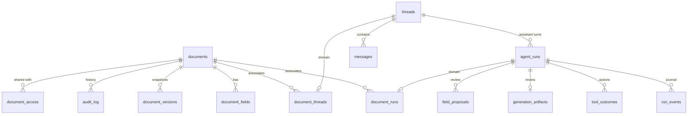

# Data model

All tables live in the `app` schema in Lakebase. The models are in `backend/domain/models.py`; the
baseline migration is `alembic/versions/v0001_baseline.py`.

## Documents

| Table | Key | What it holds |
| --- | --- | --- |
| `documents` | `id` | Type, title (copied from the `<type>.title` field), `current_version`, creator, soft-delete timestamp. |
| `document_fields` | `document_id`, `field_path` | The current value of one field (JSONB) and its provenance: `source` (`user` or `agent`), `confidence`, `confidence_reason`, `reasoning`, `citations`, `agent_run_id`, who changed it last. |
| `document_versions` | `document_id`, `version` | A snapshot of every field, taken on document proposal acceptance (or historical legacy generation). |
| `audit_log` | `id` | Append-only history: `create`, `update`, `generate`, `regenerate`, `accept_suggestion`, `share`, `unshare`, `delete`, with values before and after, the actor, and the run and trace ids. |
| `document_access` | `document_id`, `principal` | Who can see or change the document: `owner`, `edit` or `view`. The creator is the first owner. |

Fields are stored one row per field path, so adding a field to the catalog needs no migration. See
[Adding a document type or field](../guides/adding-a-document-type.md).

## Agent runs and conversations

| Table | What it holds |
| --- | --- |
| `agent_runs` | One row per agent invocation. Its `id` is the contract's `app_agent_run_id`. Holds the exact `request_payload` sent and the final `response_payload`, `step_history`, `error_code` and `error_message`, `mlflow_trace_id`, and the timestamps `submitted_at`, `last_polled_at`, `completed_at` and `materialised_at`. |
| `threads` | A generic conversation with an agent ID, private to its owner. Documents associate through `document_threads`. |
| `messages` | User and assistant messages, with the citations of assistant replies and the run that produced them. |

Because `agent_runs` keeps the request exactly as sent, any run can be replayed: against a new agent
build, or as an eval case (see [Evals](../guides/evals.md)).

## Platform tables

| Table | What it holds |
| --- | --- |
| `role_assignments` | Roles granted to users by admins. |
| `notifications` | The in-app inbox behind the bell menu. |
| `idempotency_keys` | Stored responses for requests sent with an `Idempotency-Key` header, per user, kept 24 hours. |

## Generic interactions and example-owned data

`agent_runs` adds `agent_id`, `contract_version`, validated `result`, collection `runtime_cursor`,
`event_count` and the persisted legacy/review policy. `run_kind` is an extensible string for generic
agents; new registrations do not require changing an enum. Runs and threads have no document foreign
key. `document_runs`, `document_threads` and `document_feedback` hold those domain associations.
ORM compatibility properties preserve the old document service interfaces.

`run_events` stores ordered official AG-UI events with primary key `(run_id, sequence)`.
`tool_outcomes` stores claimed/completed actions by `(run_id, tool_call_id)`. Generation owns
`generation_artifacts` (pending/accepted/rejected and validated content). Documents own
`field_proposals` (before/output/base revision/decision) and a monotonic revision on each field.
Generic lifecycle code uses callbacks rather than importing either example's data model.
