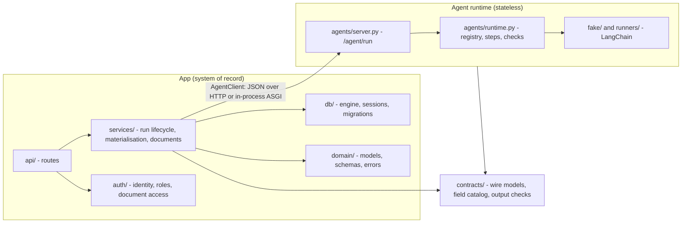

# Layers and boundaries

The backend is one Python package, `backend`, run as `python -m backend` on Databricks Apps and by
`make dev` locally. It has two halves that share only the contract.

## The app

| Layer | Package | Responsibility |
| --- | --- | --- |
| API | `backend/api/` | FastAPI routes under `/api`. Thin: resolve the user, check access, call a service, present the result (`presenters.py`). |
| Services | `backend/services/` | The work. `agent_runs.py` starts and refreshes runs; `materialise.py` writes outputs; `agent_client.py` talks to the agent; `agent_payload_builder.py` builds requests; `documents.py`, `assistant.py`, `notifications.py`. |
| Data | `backend/db/` | Async SQLAlchemy engine on psycopg 3. On Databricks Apps it signs in to Lakebase with the app's OAuth token, fetched per connection. |
| Domain | `backend/domain/` | ORM models (`models.py`), enums, API schemas (`schemas.py`, the source of the frontend's types), domain errors mapped to HTTP status codes. |
| Auth | `backend/auth/` | Identity from the Apps proxy headers, roles and permissions, per-document access. |

Requests that change data may send an `Idempotency-Key` header (`backend/middleware/idempotency.py`).
A repeat with the same key, by the same user, within 24 hours replays the stored response. Only 2xx
JSON responses are stored, so a failed request can be retried.

## The agent runtime

`backend/agents/` is the agent. It serves the contract (`POST /agent/run`, `GET /agent/run/{id}`,
`GET /contract`, `GET /healthz`), runs work on a bounded thread pool, records step history, and checks
every output against its registered result schema (document operations also check the field catalog) before reporting `succeeded`.

It may import only `backend.agents` and `backend.contracts`: no database, no services, no app settings.
`tests/agents/test_boundary.py` enforces this by parsing every module's imports, and also keeps
`backend.contracts` free of other app imports. The boundary is what lets the runtime run standalone
(`make agent`) or as its own Databricks App without code changes. See
[Splitting the agent into its own app](../guides/splitting-the-agent.md).

## One wire format, two transports

The app always calls the agent through `AgentClient` (`backend/services/agent_client.py`), with the
same JSON in both transports:

- `AGENT_TRANSPORT=inprocess` (default): `httpx.ASGITransport` into the runtime's FastAPI app, inside
  the app process. Requests are still serialised and validated, so a single-app deployment exercises
  the contract.
- `AGENT_TRANSPORT=http`: the agent at `AGENT_API_BASE`. Requests carry the app's Databricks token,
  except to a local agent on `localhost`.

The client maps failures to typed errors: `AgentTimeoutError`, `AgentRunNotFound`, `AgentRemoteError`
(an error envelope, with its code and whether it is retryable) and `AgentContractError` (a response
that does not match the models). Requests carry `User-Agent: quickstart-app agent-contract/v1`.

## Generic interaction boundary

`backend/services/interactions.py` and `backend/agents/interaction.py` are the generic application
lifecycle and runtime. They import no example modules. `backend/examples/registry.py` and
`backend/agents/example_registry.py` are explicit composition roots for app callbacks and runners.
The existing document service remains a compatibility adapter for v1; new generic operations use
`backend/contracts/execution.py`. Domain associations and proposals belong to the document example.

`frontend/src/agent/` contains the AG-UI transport adapter, provider, data hooks and composable UI.
It must not import document APIs or schemas. `frontend/src/examples/registry.tsx` owns example routes
and navigation. TanStack Query caches persisted data; AG-UI manages active state/messages/tools.
See [ADR 0011](adr/0011-generic-ag-ui-interactions.md).
