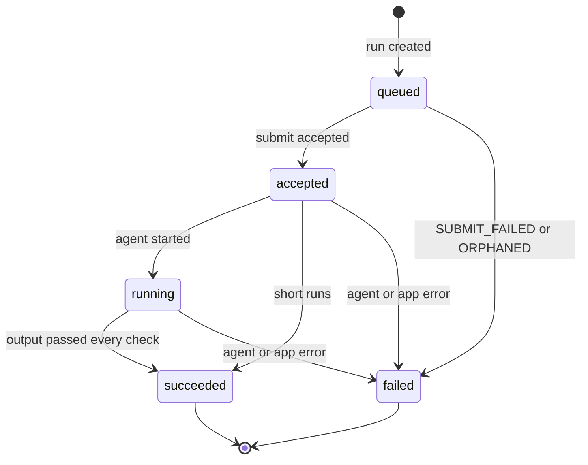

# Run lifecycle

Every agent run is a row in `agent_runs`. The app owns its lifecycle (`backend/services/agent_runs.py`);
the agent only reports progress.

## States

`queued` and `failed` with `SUBMIT_FAILED`, `ORPHANED`, `TIMEOUT`, `AGENT_RUN_LOST`, `CONTRACT_ERROR`
or `MATERIALISATION_FAILED` are app-side. A run that fails materialisation never shows `succeeded`: the
status and the failure are written in the same transaction.

1. **Start** (`start_run`). Checks the `agents:run` permission and the document access (edit for
   `generate` and `enhance_field`). Builds the full request from Lakebase: the document's fields, the
   chosen source documents the user can see (at most 5; others are left out silently), and for chat
   the last `ASSISTANT_HISTORY_LIMIT` messages (default 20). Inserts the row as `queued` with
   `request_payload` and commits, so the run exists even if the submit fails. Then submits.
2. **Refresh** (`refresh_run`). Locks the row with `SELECT … FOR UPDATE`, returns at once if the run is
   terminal, otherwise polls the agent and mirrors `status` and `step_history` into the row.
3. **Materialise**. On the first `succeeded` poll, in the same transaction.

## Failure codes

The agent reports its own errors in the `failed` status (`MODEL_ERROR`, `OUTPUT_INVALID`,
`INTERNAL_ERROR`; see the contract). The app adds its own on `agent_runs.error_code`:

| Code | When |
| --- | --- |
| `SUBMIT_FAILED` | The submit raised (agent unreachable, timed out, or rejected the request). |
| `ORPHANED` | The run is still `queued` 60 seconds after it was created: the submit never got through. |
| `TIMEOUT` | The run is not terminal after `AGENT_RUN_TIMEOUT_SECONDS` (default 600). |
| `AGENT_RUN_LOST` | The agent answered `RUN_NOT_FOUND`: it restarted and lost its in-memory registry. Start the run again. |
| `CONTRACT_ERROR` | The agent's response did not match the contract models. |
| `MATERIALISATION_FAILED` | The output failed the app's own check before it was written. |

A poll that fails with a retryable error (timeout, 5xx, a transport error) leaves the run as it is; the
next poll tries again. A non-retryable error envelope fails the run with the agent's code.

Every failure, and every successful `generate`, sends the user a notification linking to the document.

## Materialisation

What "materialise" means depends on the run kind:

| Run kind | On the first `succeeded` poll |
| --- | --- |
| `generate` | `materialise_generate` (`backend/services/materialise.py`) writes the fields. |
| `enhance_field` | Nothing. The suggestion waits in `response_payload`; the UI shows it, and accepting it is a normal field update with `accepted_from_run_id`, audited as `accept_suggestion`. |
| `assistant_turn` | The assistant's reply is stored as a message in the thread (the user's message was stored at submit). |

`materialise_generate` runs inside the refresh transaction, with the run row locked:

1. Re-checks the output against the stored request and the field catalog (`check_output`). The agent
   ran the same check; this is defence in depth.
2. Upserts each field with its provenance: value, `source = agent`, confidence, reasoning, citations,
   run id.
3. Appends one `audit_log` row per field: `generate`, or `regenerate` if the field had a value.
4. Increments `documents.current_version` and stores a `document_versions` snapshot of every field.
5. Stamps `agent_runs.materialised_at`.

Step 5 and the row lock make materialisation happen exactly once, even when the UI, the background
poller and several app instances refresh the same run at the same time.

## Who polls

- **The UI**, while someone watches the run. `useAgentRun` (`frontend/src/lib/agentRuns.ts`) polls
  `GET /api/agent-runs/{id}` after 1.5 s, multiplying the delay by 1.5 up to 10 s, and stops when the run
  is terminal. Each poll is a lazy refresh on the server. Runs still in progress come back on
  `GET /api/documents/{id}` as `active_runs`, so the UI resumes them after a reload.
- **The background poller** (`backend/workers/agent_run_poller.py`), a safety net for runs nobody is
  watching. About every `POLLER_INTERVAL_SECONDS` (default 10, with ±25% jitter) it refreshes up to 50
  active runs that were not polled in the last 3 seconds. Turn it off with `POLLER_ENABLED=false`.
