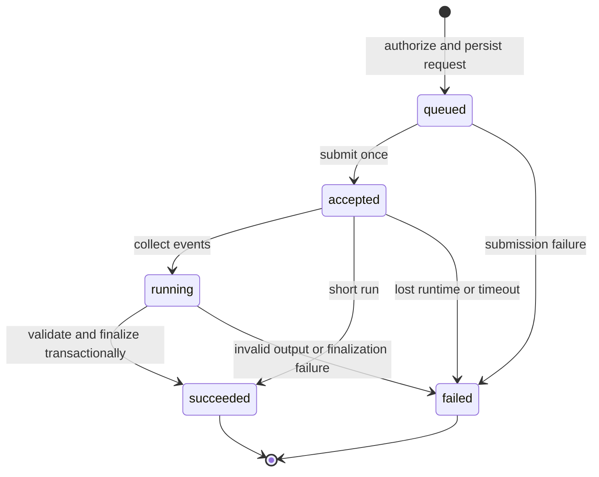

# Run lifecycle

`backend/services/interactions.py` owns generic execution. Runners receive validated input/context
and emit events and results; they never import persistence. `backend/services/agent_runs.py` remains
the compatibility service for document operations, bridged by `backend/examples/document_events.py`.

A session lock prevents overlapping conversation turns. The request and user message commit before
submission. Submissions use an idempotency key; the runtime also deduplicates by run ID. The app
rechecks the persisted status after submission so a concurrent completion cannot be overwritten.

The shared client abstracts in-process ASGI and standalone HTTP execution. Background collection
continues after browser disconnect. Collectors poll outside the database lock, then lock and reread
the run, ingest only events after the stored runtime cursor, and finalize once. Events have stable
`(run_id, sequence)` primary keys. `RUN_FINISHED` is committed only after result validation and the
application finalizer succeed. A finalizer failure rolls its writes back and publishes `RUN_ERROR`.

## Review is separate from execution

| Example | Successful finalization | Acceptance |
| --- | --- | --- |
| Chat | Persist the assistant message | Answer rating is independent feedback |
| Generation | Store a pending validated artifact | Validate edited result; atomically accept/reject |
| Documents | Store proposals with captured field revisions | Check every selected revision, write fields/provenance/audit/snapshot in one transaction |

Provisional state never writes accepted data. Document batch acceptance is all-or-nothing: a stale
selected field produces 409. Unselected edits are preserved. Repeated matching decisions are
idempotent; contradictory decisions conflict. Rejected drafts cannot later be accepted.

## Reconnection and failures

The React `DurableAgent` attaches by run ID, using SSE heartbeats. On interruption or 15 seconds
without a heartbeat it switches to JSON polling with the last processed sequence. It ignores
repeated events and detects gaps. Reload replays persisted events; no attachment submits work.
Authorization is renewed during long-lived subscriptions.

The cursor envelope is our application transport extension, not standard AG-UI SSE resumption.
A runtime restart can still lose an executing model request (`AGENT_RUN_LOST`). There is no automatic
inference retry on reconnect. Other failures include `SUBMIT_FAILED`, `TIMEOUT`, `MODEL_ERROR` and
`MATERIALISATION_FAILED`. The legacy adapter also retains its v1 error vocabulary.

## Migration

The migration preserves IDs and existing payloads/messages/feedback, moving document foreign keys to
association tables. `review_required=false` preserves the behaviour recorded for outstanding legacy
runs. New document starts set it true. Completed historical generation remains already materialised.
Rollback across the migration requires a database backup restore.
