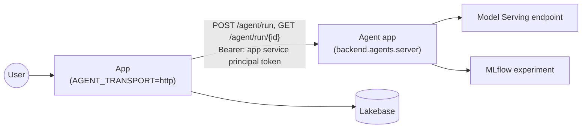

# Splitting the agent into its own app

By default the agent runtime runs inside the app (ADR 0001). Split it out when the agent needs its
own release cycle, its own compute, or a different team owns it. The contract and the code don't
change: only where the runtime runs and how the app reaches it.



## Try it locally first

```bash
make agent                     # the runtime alone on :9000
AGENT_TRANSPORT=http AGENT_API_BASE=http://localhost:9000 make dev
make contract-live AGENT_API_BASE=http://localhost:9000
```

Requests to `localhost` carry no token; anything else gets the app's Databricks token.

## Deploy the agent as a second app

`resources/app.app.yml` has a commented-out second app resource, `agent`, to start from. The agent
needs the model endpoint and the experiment, and no database: it is stateless.

1. **Same code, different command.** The agent app deploys the same source (`source_code_path: ..`).
   Its `config` block replaces `app.yaml`'s command and environment for that app only: the command
   is `uv run --frozen python -m backend.agents` (`backend/agents/__main__.py` serves the runtime on
   `DATABRICKS_APP_PORT`), and the environment is `LLM_ENDPOINT` and `MLFLOW_EXPERIMENT_ID` from its
   resources, plus `AGENT_RUNNER` if you want the fake agent there.
2. **The resource.** Uncomment `agent` in `resources/app.app.yml`.
3. **Keep the boundary.** The agent app runs `backend.agents`, which imports only
   `backend.contracts` (`tests/agents/test_boundary.py`), so it never touches the app's database.
4. **Access.** Grant the app's service principal `CAN_USE` on the agent app, for example with a
   `permissions` entry on the agent resource.
5. **The app's `app.yaml`.** Set `AGENT_TRANSPORT` to `http` and add `AGENT_API_BASE` with the agent
   app's URL. You can drop the app's own `llm-endpoint` resource if nothing else uses it.
6. **Deploy and check.** Deploy, then run
   `make contract-live AGENT_API_BASE=<agent-url> PROFILE=<profile>` against the deployed agent.

## What changes

- The agent keeps runs in memory. An agent restart fails in-flight runs with `AGENT_RUN_LOST`; users
  start them again.
- Deploy the agent before the app when the contract gains something the app uses.
- Traces are written by the agent app; the app still stores `trace_id` on each run.
- `GET /api/health` on the app shows `transport: http` and no runner list; the agent's `/healthz`
  shows its runners.
