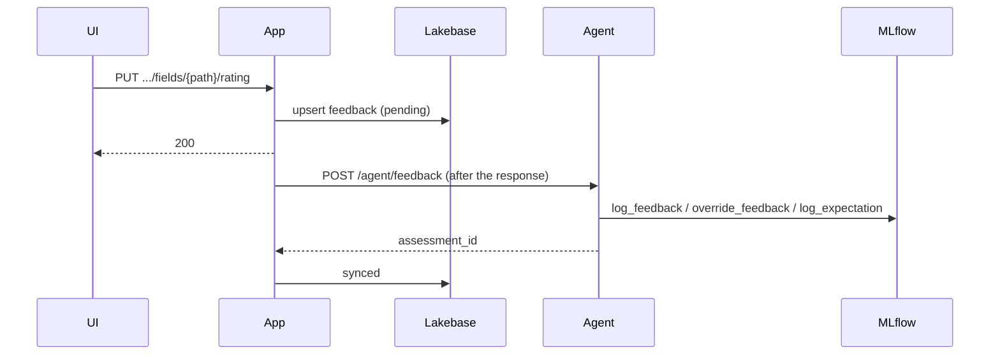

# User feedback and evaluation

Every agent run has an MLflow trace. Users' reactions to what the agent wrote are stored on that
trace, so in Databricks you can see how the agent does on real work and turn the weak spots into
eval cases. The design is in ADR 0010; the wire format in the contract, section 7.

## What is captured

| Signal | When | On the trace |
| --- | --- | --- |
| Field rating | thumbs up/down on a value the agent wrote, optional reasons and comment | feedback `field_rating` (`true`/`false`), metadata `field_path`, `reasons` |
| Answer rating | thumbs up/down on an assistant answer | feedback `answer_rating`, metadata `message_id`, `thread_id` |
| Suggestion verdict | accepting or dismissing an `enhance_field` suggestion | feedback `suggestion_accepted` |
| Correction | editing a value the agent wrote | expectation named after the field, `.` written as `__` (e.g. `brief__risks`), holding the new value; `metadata.field_path` has the real path |

Every assessment has a `HUMAN` source with the user's email, and metadata with the run id
(`app_agent_run_id`), the document and its type. Traces also carry the user (`mlflow.trace.user`)
and a session: `thread:<id>` for chat, `document:<id>` for everything else.

Reasons: accurate, usable as is, factually incorrect, not supported by the sources, missing detail,
too long, wrong tone. They are the contract's `FEEDBACK_REASONS`; change them there (and the labels
in `frontend/src/components/documents/values.ts`).

## How it flows



If the agent or MLflow is unavailable, the row stays `pending` and `FeedbackSender`
(`backend/workers/feedback_sender.py`) retries it with backoff (30 s, doubling, up to an hour; it gives
up after 8 tries). Locally, with no MLflow experiment, runs have no trace and feedback is kept with
the status `skipped`. Look at the `feedback` table to see the state of each item.

## Using it in Databricks

**In the MLflow UI.** Open the agent's experiment (`resources/mlflow.experiment.yml` names it) and
its **Traces** tab: assessments appear as columns and on each trace, and you can filter by user,
session, tags and assessment values. A trace shows the full request the agent got, so you can see
why it wrote what it wrote.

**In code.**

```python
import mlflow

mlflow.set_tracking_uri("databricks://<profile>")
bad = mlflow.search_traces(
    locations=["<experiment id>"],
    filter_string="tags.has_negative_feedback = 'true'",
    return_type="list",
)
for trace in bad:
    for a in trace.search_assessments(type="feedback"):
        print(a.metadata.get("field_path"), a.feedback.value, a.metadata.get("reasons"), a.rationale)
```

Databricks' trace search filters on tags, not on assessment values, so the agent also tags a trace
when it stores feedback on it: `has_feedback`, `has_negative_feedback` (something was rated down or a
suggestion dismissed) and `has_correction`. Tags are only ever set, never cleared. Combine them with
the run's own tags, e.g. `tags.run_kind = 'generate'` or `tags.prompt_version = 'generate@2'`, then
look at the assessments of the traces you get back.

**As eval cases.**

```bash
make eval-dataset PROFILE=<profile> EXPERIMENT=<id or path> [DAYS=30] [UC_TABLE=catalog.schema.table]
```

`evals/from_feedback.py` writes one row per trace with feedback to `evals/feedback_dataset.jsonl`
(git-ignored: it holds user content): the request the agent got, the users' corrections as
`expected_facts`, and the ratings with their reasons and comments. Review the rows, add expected
facts where a row was rated down without a correction, and copy the good ones into
`evals/dataset.jsonl`, or run them directly:

```bash
DATABRICKS_CONFIG_PROFILE=<profile> LLM_ENDPOINT=<endpoint> uv run python -m evals.run \
  --dataset evals/feedback_dataset.jsonl
```

With `UC_TABLE`, rows with corrections are also merged into a Unity Catalog evaluation dataset that
`mlflow.genai.evaluate` and the Databricks UI can use.

**Further.** Once there is enough feedback: have subject-matter experts label traces in a labeling
session, align an LLM judge with their labels so it scores like they do, and schedule that judge on
production traces to watch quality over time. See MLflow's documentation on human feedback,
labeling sessions and judge alignment.

## Adding a signal

1. Pick a name and add it to `FEEDBACK_NAMES` and the contract's section 7 (with an example if its
   shape is new).
2. Record it with `feedback.record` in `backend/services/feedback.py` from the place where the user
   acts, then call `deliver_feedback()` in the route.
3. Add a test in `tests/backend/test_feedback.py` - the `tracer` fixture shows what reached the trace.
