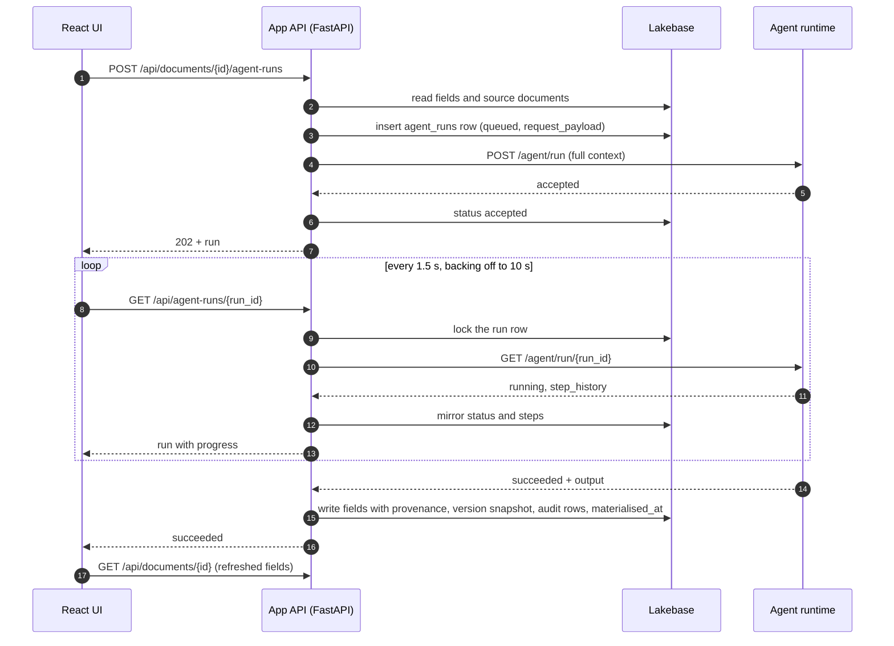

# Overview

This template is a starting point for a Databricks App that pairs an application with an AI agent.
It has a FastAPI backend and a React frontend in one app, app state in Lakebase Postgres, and an agent
runtime that the app calls through a versioned contract.

The design follows three rules:

- **The app is the system of record.** Documents, fields, versions, audit history, conversations and
  access all live in Lakebase. Only the app writes to the database.
- **The agent is stateless.** It owns inference only. Every request carries the full context the agent
  needs, and the agent keeps a run only until the app has polled the result.
- **App and agent meet at a contract.** An async submit/poll API, described in
  `contracts/agent-api-contract.md` and mirrored by Pydantic models. A fake agent implements the same
  contract, so app work and agent work can proceed in parallel.

The sample domain is a **brief**: a user enters a title and a goal, and the agent drafts a summary, key
points, risks and next steps. Replace it with your own document types in
`contracts/field-catalog.yaml`.

## From request to materialised fields

A user clicks **Generate** on a document. The app builds the request from Lakebase, records the run,
and submits it. The UI polls the run; each poll lets the app refresh it from the agent. When the run
first succeeds, the app writes the output to the document in one transaction.

If nobody is watching (the tab was closed), a background poller in the app does the same refresh, so
every run still reaches a final state and is materialised. See
[Run lifecycle](architecture/run-lifecycle.md).

## Repository layout

| Path | What it holds |
| --- | --- |
| `app.yaml` | Databricks Apps start command (`python -m backend`) and environment |
| `databricks.yml`, `resources/` | Bundle: dev/test/prod targets, the app, its Lakebase project, an MLflow experiment |
| `contracts/` | `agent-api-contract.md` (the golden record) and `field-catalog.yaml` |
| `backend/contracts/` | Pydantic models of the contract, the field catalog loader, output checks |
| `backend/agents/` | The agent runtime: HTTP server, run registry, fake and LangChain runners, prompts |
| `backend/api/` | REST routes under `/api` |
| `backend/services/` | Agent client, run lifecycle, materialisation, documents, assistant, notifications |
| `backend/db/`, `alembic/` | Async SQLAlchemy engine with Lakebase sign-in; migrations, applied at startup |
| `backend/domain/` | ORM models, enums, API schemas, domain errors |
| `backend/auth/` | Identity from the Apps proxy, roles and permissions, per-document access |
| `backend/middleware/`, `backend/workers/` | `Idempotency-Key` handling; the background run poller |
| `frontend/` | React 19, Vite, Tailwind CSS 4, shadcn/ui, TanStack Query; types generated from the API |
| `evals/` | MLflow 3 evaluation of the agent, offline with the fake agent or against a real endpoint |
| `tests/` | `contracts/`, `agents/` and `backend/` suites, against real Postgres (pgserver) |
| `docs/` | This site |

## Where to start

- New to the template: [Getting started](guides/getting-started.md).
- Working on the agent: [The agent contract](guides/agent-contract.md) and
  [Fake agent and parallel work](guides/fake-agent.md).
- Changing the data: [Adding a document type or field](guides/adding-a-document-type.md).
